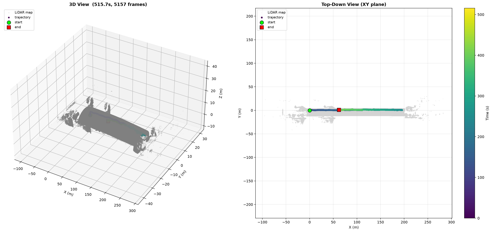

# UAV LiDAR Dataset

PX4 + 机载激光雷达无人机原始飞行记录（ROS1 bag），含 IMU、多源里程计与 3D 点云，用于状态估计、SLAM 与自主导航算法研究。

> 📄 [论文介绍视频](paper_demo.mp4) — 数据集背景与方法概述。


## 数据集结构

```
├── bags/                          # ROS bag（LiDAR、图像、MAVROS 感知话题）
│   ├── underactuated-tunnel/      # 欠驱动隧道实验组
│   │   └── 20251125/
│   └── fully-actuated-tunnel/     # 全驱动隧道实验组
│       └── 20260112/
├── logs/                          # PX4 ULG 飞控日志（控制、EKF、电机、姿态）
│   └── underactuated-tunnel/
│       └── 20260112/
├── videos/                        # 同步实拍外景视频
│   └── underactuated-tunnel/
│       ├── 20251125/
│       └── 20260107/
├── scripts/                       # 读取、可视化、bag/ulg 解析、评估脚本
├── docs/preview/                  # 预览图、示意图、标注截图
├── paper_demo.mp4                 # 仓库总介绍视频（论文 demo，不是单实验实拍）
├── README.md
└── .gitattributes                 # LFS：*.bag *.mp4（*.ulg 走普通 Git）
```

> 仅保留有数据的日期目录；后续补充 bag / log / video 时再建对应文件夹。

## Directory Structure

- `bags/`: ROS bag files, containing LiDAR, camera, MAVROS perception topics.
- `logs/`: PX4 ULG flight logs, including state estimation, actuator and control data.
- `videos/`: Synchronized raw field recording videos.
- `scripts/`: Data parsing, visualization and evaluation scripts.
- `docs/preview/`: Preview figures and schematic diagrams.

## Git LFS 策略

| 类型 | 是否 LFS | 原因 |
|------|----------|------|
| `*.bag` | 是 | 常超过 GitHub 100MB 普通文件上限，且可达 ~2GB |
| `*.mp4` | 是 | 外景/介绍视频体积大，统一用 LFS |
| `*.ulg` | 否 | 通常几十 MB，普通 Git 即可，节省 LFS 配额 |

> GitHub 对非 LFS 文件：**>100MB 拒绝 push**，>50MB 仅警告。若日后单条 ulg 超过 100MB，再单独改用 LFS 或拆分。

## 硬件配置

| 组件 | 说明 |
|------|------|
| 飞控 | PX4 (MAVROS) |
| 激光雷达 | 机载固态 LiDAR（10Hz 点云输出） |
| IMU | 飞控内置（50Hz） + 激光雷达内置（200Hz） |
| 欠驱平台 | 四旋翼无人机 |
| 全驱平台 | 六轴全驱动无人机（可侧飞、定点悬停） |

## 话题列表

| 话题 | 类型 | 频率 | 说明 |
|------|------|------|------|
| `/mavros/local_position/odom` | nav_msgs/Odometry | 30Hz | 融合里程计 |
| `/mavros/odometry/in` | nav_msgs/Odometry | 30Hz | 外部里程计输入 |
| `/ali_odom` | nav_msgs/Odometry | 10Hz | 激光/视觉里程计 |
| `/mavros/imu/data` | sensor_msgs/Imu | 50Hz | 融合 IMU |
| `/mavros/imu/data_raw` | sensor_msgs/Imu | 50Hz | 原始 IMU |
| `/livox/imu` | sensor_msgs/Imu | 200Hz | 激光雷达内置高频 IMU |
| `/ali_cloud` | sensor_msgs/PointCloud2 | 10Hz | 原始点云 |
| `/cloud_registered` | sensor_msgs/PointCloud2 | 10Hz | 配准后世界系点云 |
| `/mavros/vfr_hud` | mavros_msgs/VFR_HUD | 20Hz | 空速/油门/高度 |
| `/mavros/battery` | sensor_msgs/BatteryState | 0.5Hz | 电池状态 |

## Bag 文件列表

### 欠驱-隧道（underactuated-tunnel）

#### 20251125

| 文件 | 时长 | 大小 | 场景 | 预览 |
|------|------|------|------|------|
| `bags/underactuated-tunnel/20251125/2025-11-25-16-20-29.bag` | 191.6s | ~1.96GB | 室外飞行（含建图） | [preview](docs/preview/underactuated/preview_16-20-29.png) |
| `bags/underactuated-tunnel/20251125/2025-11-25-16-26-22.bag` | 81.8s | ~924MB | 室外飞行（含建图） | [preview](docs/preview/underactuated/preview_16-26-22.png) |
| `bags/underactuated-tunnel/20251125/2025-11-25-16-29-19.bag` | 7.0s | ~80MB | 隧道静态扫描 | [preview](docs/preview/underactuated/preview_16-29-19.png) |

### 全驱-隧道（fully-actuated-tunnel）

> 因 GitHub LFS 单文件 2GB 限制，每个长 bag 按时间边界切成 3 个分片（`_part1/2/3.bag`）。
> 用户下载后用 `rosbags` 的 `AnyReader([part1, part2, part3])` 或 `rosbag play part1 part2 part3` 即可拼接使用。

#### 20260112

| 文件 | 时长 | 大小 | 场景 | 预览 |
|------|------|------|------|------|
| `bags/fully-actuated-tunnel/20260112/2026-01-12-16-42-10_part1.bag` | ~320s | ~1.82GB | 全驱平台隧道飞行（前半段） | [preview](docs/preview/fully-actuated/preview_16-42-10.png) |
| `bags/fully-actuated-tunnel/20260112/2026-01-12-16-42-10_part2.bag` | ~130s | ~1.82GB | 全驱平台隧道飞行（中段） | 同上 |
| `bags/fully-actuated-tunnel/20260112/2026-01-12-16-42-10_part3.bag` | ~65s | ~1.20GB | 全驱平台隧道飞行（后半段） | 同上 |
| `bags/fully-actuated-tunnel/20260112/2026-01-12-17-05-23_part1.bag` | ~310s | ~1.82GB | 全驱平台隧道飞行（前半段） | [preview](docs/preview/fully-actuated/preview_17-05-23.png) |
| `bags/fully-actuated-tunnel/20260112/2026-01-12-17-05-23_part2.bag` | ~130s | ~1.82GB | 全驱平台隧道飞行（中段） | 同上 |
| `bags/fully-actuated-tunnel/20260112/2026-01-12-17-05-23_part3.bag` | ~55s | ~1.03GB | 全驱平台隧道飞行（后半段） | 同上 |



## 同步视频与飞控日志（欠驱）

| 日期 | videos | logs |
|------|--------|------|
| 20251125 | `videos/underactuated-tunnel/20251125/track_test.mp4` | — |
| 20260107 | `videos/underactuated-tunnel/20260107/tunnel_test.mp4` | — |
| 20260112 | — | `logs/underactuated-tunnel/20260112/log_44_*.ulg` 等 3 个 |

## 快速开始

### 环境依赖

```bash
pip install rosbags matplotlib numpy
```

### 查看话题信息

```bash
# 扫描指定日期目录下所有 .bag 文件
python scripts/inspect_bag.py bags/underactuated-tunnel/20251125/

# 或指定单个 bag
python scripts/inspect_bag.py bags/underactuated-tunnel/20251125/2025-11-25-16-20-29.bag
```

### 绘制点云建图 + 轨迹叠加图

```bash
# 指定 bag 和输出路径
python scripts/plot_map_trajectory.py bags/underactuated-tunnel/20251125/2025-11-25-16-26-22.bag output.png
```

### 使用分片 bag（全驱-隧道场景）

因 GitHub LFS 单文件 2GB 限制，全驱场景的长 bag 被切成 3 个分片（`_part1/2/3.bag`）。数据无损，按时间边界切分。

**直接读取（推荐，无需合并）：**

```python
from rosbags.highlevel import AnyReader
from pathlib import Path

# 把同一原始 bag 的所有分片作为列表传入，自动按时间戳拼接
bag_paths = [
    Path("bags/fully-actuated-tunnel/20260112/2026-01-12-16-42-10_part1.bag"),
    Path("bags/fully-actuated-tunnel/20260112/2026-01-12-16-42-10_part2.bag"),
    Path("bags/fully-actuated-tunnel/20260112/2026-01-12-16-42-10_part3.bag"),
]
with AnyReader(bag_paths) as reader:
    for conn, ts, raw in reader.messages():
        ...
```

**ROS 命令行播放：**

```bash
rosbag play \
  bags/fully-actuated-tunnel/20260112/2026-01-12-16-42-10_part1.bag \
  bags/fully-actuated-tunnel/20260112/2026-01-12-16-42-10_part2.bag \
  bags/fully-actuated-tunnel/20260112/2026-01-12-16-42-10_part3.bag
```

**维护者工具（重新分片）：**

```bash
# 把超过 2GB 的 bag 切成每片 ≤1800MB
python scripts/split_bag.py large.bag --max-size 1800
```

> **注意：** `*.bag` 与 `*.mp4` 使用 Git LFS 管理，请先安装 [Git LFS](https://git-lfs.github.com/) 再 clone。`*.ulg` 为普通 Git 对象，无需 LFS 即可获取。
